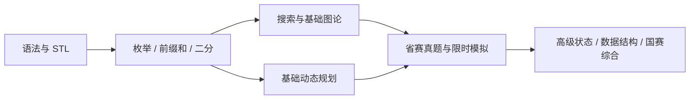

# 蓝桥杯 C/C++ 大学 B 组 · 从基础到国一方向

为“有多语言开发经验、C/C++ 基础语法会写、STL 和算法尚不熟”的学习者设计。以 **C++17、本地项目实验、真题迁移、闭卷复写**为主线。按你确认的 **每周 8–10 小时**安排，从 **2026-10-21** 训练到 **2027 年四月省赛**，再衔接国赛。

国一是训练方向，无法用固定题数、固定分数或学完某份清单保证。这里的能力目标是：基础题稳定实现、常见中档题独立建模、综合题能拆成已知模型并写出可验证的算法。[目标与赛制说明](docs/goals-and-rules.md)

## 先从这里开始

1. 看 [环境配置](docs/setup.md)，确认 `g++ --version` 和 Python 3.10+ 可用。
2. 按 [第一周 9 小时操作单](docs/first-week.md) 开始，只开 `00-basics`。
3. 用 [26 周日历](docs/weekly-plan.md) 决定本周必做项；高级专题不用提前啃。
4. 每题先做自己的版本，再看折叠提示，最后读参考代码。[学习方法](docs/how-to-learn.md)

```bash
# 在仓库根目录运行；Windows 可将 python3 换成 python 或 py -3
python3 scripts/lab.py list
python3 scripts/lab.py start sum64
# 编辑 practice/sum64.cpp 后：
python3 scripts/lab.py check sum64 --mine
python3 scripts/lab.py log sum64 --status solved --minutes 40 --note "先估计了总和上界"
python3 scripts/lab.py progress
```

**不带 `--mine` 会检查参考实现。** 不要把参考代码的 PASS 当成自己的完成记录。

## 仓库里有什么

- **12 个递进项目、28 个原创教学主任务**：每题有明确输入输出、约束、自编样例、提示、复杂度、常见错误和两道升级练习。
- **6 道真题的独立注释实现**：好数、冶炼金属、飞机降落、砝码称重、统计子矩阵、国赛删边问题；共 **34 个可独立编译的 C++ 程序**。
- **41 道历年真题索引**：[历年真题分层索引](resources/problem-ladder.md)、[整套试卷入口](resources/past-papers.md)、[GitHub 与学习资源](resources/catalog.md)、[经验帖提炼](resources/experience.md)。2025、2026 省赛留作盲测。
- [STL 速查](docs/stl.md)、[算法建模笔记](docs/algorithm-thinking.md)、[国赛补充任务](docs/national-extension.md)、[模拟赛流程](mock/README.md)、复盘模板和 CSV 进度表。
- Python 标准库编写的练习工具、固定样例与边界用例、独立暴力对拍及 GitHub Actions 配置。运行不依赖外部服务。

升级练习共 68 个开放任务（含真题后的迁移练习），不附各自独立答案；外部题单也不是完整题解镜像。完整参考答案和自动测试覆盖上面的 34 个主任务。

## 项目路线

| 项目 | 要做出的东西 | 核心能力 | 建议 |
| --- | --- | --- | --- |
| [00 基础](projects/00-basics/README.md) | 训练日志统计 | 输入输出、整数范围、枚举 | 先完成 |
| [01 STL](projects/01-stl/README.md) | 排行榜、词频、括号检查 | vector/string/sort/map/stack | 必做 |
| [02 区间](projects/02-range/README.md) | 统计引擎 | 前缀和、差分、双指针 | 必做 |
| [03 决策](projects/03-decisions/README.md) | 运输容量、会议预约 | 二分答案、贪心证明 | 必做 |
| [04 搜索](projects/04-search/README.md) | 迷宫与装备方案 | BFS、DFS、剪枝 | 必做 |
| [05 图论](projects/05-graphs/README.md) | 校园网络实验室 | 并查集、最短路、最小生成树 | 必做 |
| [06 DP](projects/06-dp/README.md) | 训练收益规划 | 背包、序列 DP | 必做 |
| [07 数学](projects/07-math/README.md) | 数论工具箱 | 筛法、快速幂 | 穿插在 W10 |
| [08 结构](projects/08-structures/README.md) | 实时日志分析 | 树状数组、单调队列、KMP | 按周计划取舍 |
| [09 DP 提高](projects/09-advanced-dp/README.md) | 合并与树形决策 | 区间 DP、树形 DP | 省赛前选一，国赛前补齐 |
| [10 状态压缩](projects/10-state-dp/README.md) | 配送路线、超大范围计数 | 状压 DP、数位 DP | 国赛进阶 |
| [11 综合](projects/11-capstone/README.md) | 网络可靠性分析器 | 离线处理、桥、综合建模 | 国赛进阶 |

项目编号是知识组织顺序，实际周次以日历为准；数学不必等到 DP 后才学。[全部任务按难度排序](docs/task-index.md)



## 验证与记录

```bash
python3 scripts/lab.py check all       # 参考实现固定用例
python3 scripts/verify.py              # 小规模暴力对拍 + 大规模性质检查
python3 scripts/lab.py check all --sanitize  # 可选：编译器支持时检查未定义行为
```

[本次验证结果](docs/validation.md)。外部 OJ 题目需到原平台自行提交；本地测试通过不等于覆盖官方全部数据。

训练记录：[progress/weekly-plan.csv](progress/weekly-plan.csv)；每题复盘用 [review-template.md](templates/review-template.md)，模拟赛用 [mock-review.md](templates/mock-review.md)。

## 来源与维护

资料检索日期 **2026-10-21**。链接按“正文已读 / 题集目录已核对 / 搜索索引可见 / 页面受限”说明，不把社区题解当成官方赛制。官网页面依赖动态加载，本次未读到第十八届完整规程；具体日期、资格、语言标准请跟踪学校及 [官方赛事入口](https://dasai.lanqiao.cn/)。

代码为本仓库独立编写，没有批量搬运第三方题解或受限题库。原创部分使用 [MIT License](LICENSE)，外部题目、文档和仓库保留各自权利与许可证。你可以直接在这个本地 Git 仓库继续训练；上传 GitHub 的方法见 [环境配置](docs/setup.md#保存到-github)。
